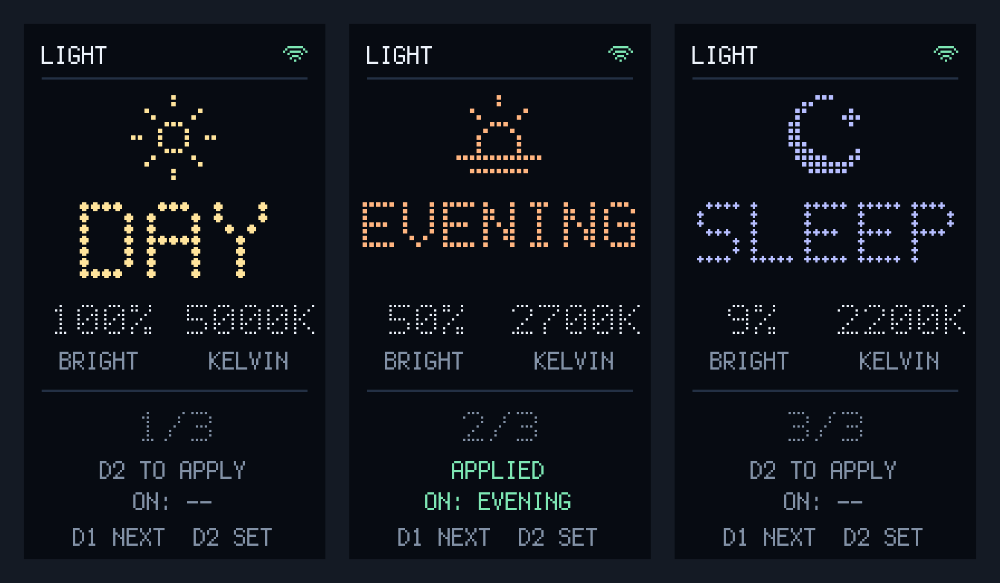

# Light Controller

A physical Home Assistant light controller for the **Adafruit ESP32-S3 Reverse
TFT Feather (5691)**, running CircuitPython.

The portrait UI displays one mode at a time: a large dotted bitmap title,
sun/sunset/moon icon, brightness, Kelvin, and a `1/n` position indicator.
**D1** cycles through all configured modes; **D2** applies the displayed mode.
`ON:` shows the last successfully applied mode. The Wi-Fi icon turns green
when connected. The font and icons are built into the firmware.



## Project layout

```text
code.py                CircuitPython application
boot.py                Suppress the display's boot/REPL console
config.json            Example light entity and modes
settings.toml.example  Wi-Fi and Home Assistant settings template
docs/SETUP_GUIDE.md     Board setup and library installation
assets/ui-preview.png  Preview of the three default modes
scripts/check.py       Host-side syntax and configuration checks
scripts/package.py     Create a board-ready application ZIP
```

This is firmware, so `code.py` and `boot.py` remain at the project root to
match the CIRCUITPY drive layout. The application runs on the Feather;
the development scripts run on a computer with Python 3.9 or newer.

## Board setup

1. Install CircuitPython and the matching Adafruit libraries using the
   [setup guide](docs/SETUP_GUIDE.md).
2. Copy `code.py`, `boot.py`, and `config.json` to the CIRCUITPY root.
3. Copy `settings.toml.example` to the board as `settings.toml`, then enter
   your Wi-Fi credentials, Home Assistant URL, and long-lived access token.
4. Set your light's entity ID and desired modes in the board's `config.json`.
5. Reset the board. D1 cycles; D2 applies.

The board needs `adafruit_display_text`, `adafruit_requests`, and
`adafruit_connection_manager` in `CIRCUITPY/lib`. These libraries and
CircuitPython itself are installed separately and are not included in the ZIP.

## Development and packaging

```sh
make check
make package
```

Or run the scripts directly:

```sh
python3 scripts/check.py
python3 scripts/package.py
```

Checks parse the Python files and validate the sample modes and settings
template without importing CircuitPython hardware modules. They do not
replace testing the UI and buttons on the board.

Packaging produces `dist/light-controller.zip`, containing the firmware,
configuration and settings templates, license, README, and setup guide.
It always uses an explicit file list and excludes local credentials.
No Python packages are needed for either development command.

## Modes and orientation

Each mode has a `name`, `brightness` (0–255), and positive `kelvin` value.
The list can contain any nonzero number of modes. An optional `icon` value
(`sun`, `sunset`, or `moon`) overrides automatic icon selection.

Portrait rotation is `90` degrees in `code.py`; use `270` if mounting the
board in the opposite orientation. Long names are shortened on screen.

The default `config.json` is a template. `settings.toml` is ignored by Git;
keep your credentials in that local file or directly on the board.

## License

[MIT](LICENSE), matching the existing firmware license headers.
