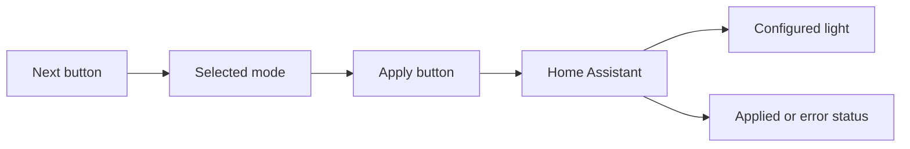

# Light Controller

A physical Home Assistant light controller with DAY, EVENING, SLEEP and OFF
presets. Select a mode on the screen, then press the apply button to send it.

| Board | Firmware | Next / apply | Setup |
| --- | --- | --- | --- |
| Adafruit ESP32-S3 Reverse TFT Feather (5691) | CircuitPython, repository root | D1 / D2 | [Feather guide](docs/SETUP_GUIDE.md) |
| M5Stack StickS3 (K150) | Arduino C++, `sticks3/` | A / B | [StickS3 guide](https://github.com/jhojin7/light-controller/tree/main/sticks3) |

Both versions have a 135 × 240 portrait display with dotted headings, mode icons,
brightness, color temperature and a page counter. StickS3 also shows battery
percentage, charging state and a low-battery indicator.

Selecting a mode does not change the light. `ON:` and `LIGHT OFF` show the last
successful controller command. The Wi-Fi icon turns green when connected;
it does not indicate whether Home Assistant authentication succeeded.

## Configuration

Both versions use the same mode JSON and Wi-Fi/Home Assistant settings.
Start with `config.json.example` and `settings.toml.example`, then follow the
[configuration reference](docs/CONFIGURATION.md).

## Development

Run commands from the directory for the board you are using:

| Task | Feather: repository root | StickS3: `sticks3/` |
| --- | --- | --- |
| Install host tools | Python 3.9+; no host packages | `make setup` with Python 3.11+ |
| Local checks | `make check` and `make test` | `make check` |
| Build or package | `make package` | `make build` |
| Board and read-only HA checks | `make e2e` | `make e2e` |
| Apply real presets and restore the light | `make e2e-live` | `make e2e-live` |

The Feather ZIP is written to `dist/light-controller.zip`. It contains the
application, documentation and configuration templates. CircuitPython and its
libraries are installed separately.

See [behavior and board differences](docs/FEATURE_MAP.md) and
[testing and recovery](docs/TESTING.md). The two implementations have separate
build and deployment commands.

## License

[MIT](LICENSE).
