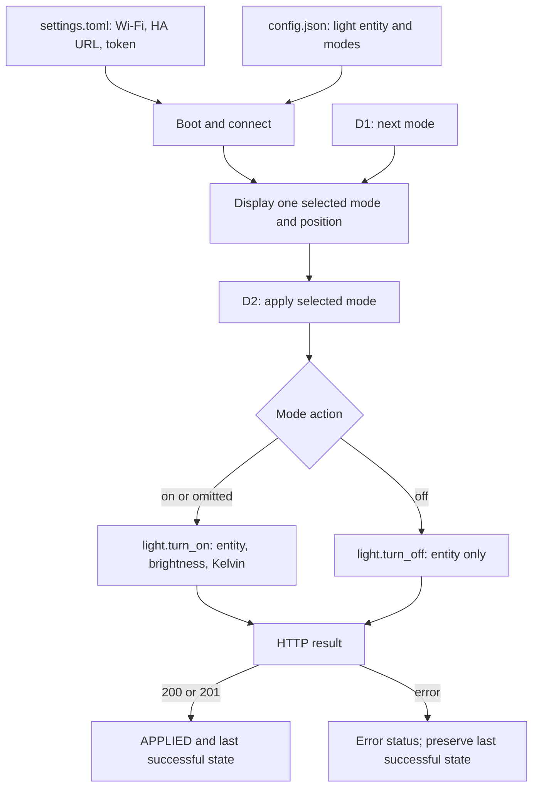

# Feature map

This maps the controller's user-visible behavior to repeatable verification.
The supported hardware is the Adafruit ESP32-S3 Reverse TFT Feather (5691),
with a 135 × 240 portrait screen and CircuitPython. The software has four
main boundaries: configuration files, display output, D1/D2 inputs, and the
Home Assistant REST API.

## Default modes

| Mode | Action | Brightness | Temperature | Icon |
| --- | --- | --- | --- | --- |
| DAY | `on` | 255/255, displayed 100% | 5000 K | Sun |
| EVENING | `on` | 128/255, displayed 50% | 2700 K | Sunset |
| SLEEP | `on` | 25/255, displayed 9% | 2200 K | Moon |
| OFF | `off` | Displayed 0% | Displayed `--` | Power |

Brightness percentages truncate to integers. Device-reported values can be
rounded by the light integration. An OFF entry needs only
`{"name": "OFF", "action": "off"}`; it sends neither brightness nor Kelvin.
Older three-mode configurations still work. Add the OFF entry to make it selectable.

## Features and verification

| Feature | Contract | Automated verification |
| --- | --- | --- |
| Startup | Load settings, connect Wi-Fi, draw a portrait card, enter button loop | `entry-point`, `startup-and-navigation`, `real-ha-connectivity` |
| Mode configuration | Read one light entity and a nonempty mode list; no three-mode limit | `single-mode-wrap`, `seven-modes-and-long-names` |
| Missing/invalid JSON | Use built-in defaults, including OFF | `missing-config-fallback`, `malformed-config-fallback` |
| Empty mode list | Show an ERROR card rather than crash during drawing | `empty-config-error-card` |
| Dotted typography | Built-in uppercase 5×7 dot font; reduce size/truncate long labels | Bitmap goldens, `seven-modes-and-long-names` |
| Icons | Sun/sunset/moon based on name or temperature; optional explicit icon; power for OFF | `screen-day`, `screen-evening`, `screen-sleep`, `screen-icon-override`, `screen-off` |
| Layout | One mode at a time; no clipping/overlapping text; refresh restored after redraw | Every scripted frame, bitmap goldens |
| Navigation | Show `1/n`; D1 advances and wraps | `startup-and-navigation`, one/seven-mode traces, `off-and-back-on` |
| Debounce/hold | Accept input only more than 0.3 s after the last accepted input; a held button repeats | `button-debounce-and-hold-repeat`, `confirm-debounce` |
| Simultaneous input | D1 selection runs before D2 apply in the same iteration | `simultaneous-buttons-cycle-before-apply` |
| Apply preset | D2 sends Bearer-authenticated `POST /api/services/light/turn_on` with configured entity, brightness and Kelvin | `apply-all-presets`, live preset cases |
| Switch off/on | D2 on OFF calls `light.turn_off`; next on preset works normally | `off-and-back-on`, `real-preset-4` with the default config, `real-on-after-off` |
| Applied state | HTTP 200/201 shows APPLIED; remember the last successful mode across selection changes | `apply-all-presets`, `success-201` |
| Applied OFF state | Show LIGHT OFF after successful off; selecting DAY alone does not turn it on | `off-and-back-on` |
| Request failure | Show HTTP error or FAILED; keep the previous successful applied state | `request-failure-401`, `request-failure-500`, `request-failure-raise`, `failed-off-preserves-last-applied` |
| Missing credentials/network | No light request without Wi-Fi/session/token | `missing-wifi`, `failed-wifi`, `missing-token` |
| Connection indicator | Wi-Fi icon color reflects the startup connection result | Reviewed startup bitmap goldens; real connectivity check |
| Response resources | Close returned HTTP responses on success and HTTP errors | Every simulated HTTP scenario |
| Live recovery | Snapshot the light, apply actual presets, restore and verify state, delete temporary scene | `light-state-restored` |
| Test sensitivity | Reject known wrong rotation, stalled navigation, wrong Kelvin and wrong OFF service | `reject-regression-*` negative controls |
| Serial recovery/privacy | Bounded timeouts, cancel before recovery, restart installed firmware; suppress arbitrary board tracebacks | `make test` pseudo-terminal integration tests |

Test cases live in `tests/scenarios.py`; the actual board adapters and live checks
are in `tests/board_suite.py`. Run instructions and evidence are in
[TESTING.md](TESTING.md).

## State and implementation boundaries

- D1 changes the selection only; D2 changes the light. `ON:`/`LIGHT OFF` is the
  controller's last successful command, not a continuously synchronized HA state.
- Configuration and credentials are read at startup. Restart after editing them.
- The event loop is synchronous. Network calls temporarily block button handling.
- Wi-Fi connects at startup. There is no automatic reconnect, periodic HA health
  polling, or request retry yet. The green icon does not prove HA authentication.
- A missing network can currently be reported as NO TOKEN after an apply attempt;
  tests verify that no request is sent, without treating that wording as ideal UX.
- Host configuration validation is stricter than the firmware loader. A malformed
  JSON file falls back, but a structurally valid JSON object with missing fields
  can still fail. Arbitrary untrusted configuration is not supported.
- Automated tests supply D1/D2 logical input levels; they cannot physically press
  switch contacts. They inspect the actual display scene, not a photograph of the
  TFT, and observe the light through HA, not an optical sensor.
