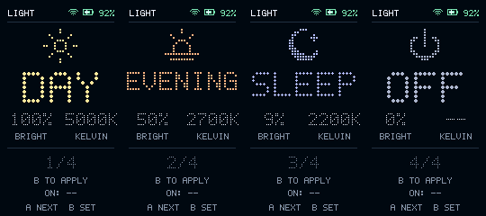
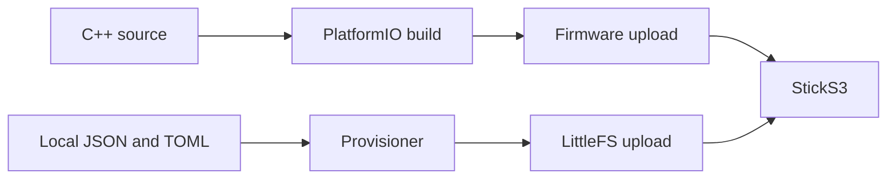

# Light Controller for StickS3

Arduino C++ firmware for the **M5Stack StickS3 K150**. **Tap A** (front, GPIO11)
to cycle presets; **hold A for 700 ms** to apply the displayed preset once.
**B** (side user button, GPIO12) sleeps/wakes the controller. The separate
power/reset button keeps its system function. Two short A taps advance twice;
there is no double-click shortcut. Holding A never also advances the selection.

Picking it up also wakes the screen. Wi-Fi reconnects automatically in the
background as soon as the device wakes, remains enabled while awake, and turns
off for sleep. Radio power saving is disabled during these brief awake sessions
to keep requests responsive. The screen and keys keep working while connection/requests wait.
If you hold A before connection finishes, that preset applies automatically
once connected; there is no second hold to confirm.

| Event | Behavior |
| --- | --- |
| No interaction after wake | Screen off after 3 seconds |
| A interaction | Start/reset a 15-second browsing inactivity window |
| Apply succeeds | Show APPLIED for 3 seconds, then sleep |
| Apply fails | Show error for 8 seconds; hold A to retry, tap A to browse |
| B during apply | Finish or time out the command, then sleep |

Motion does not extend an awake session or change the light. Sleep/wake never
changes the light; OFF is still a preset. Keys must be released before sleep and
after a key-triggered wake. Sleep entry allows a short settling interval; ongoing
motion uses light sleep until quiet before entering indefinite deep sleep.
Preset selection and last successful command survive deep sleep; configuration
changes invalidate cached indices safely. They do not track external HA changes.

The top right shows battery percentage and charging state. A discharging battery
at 20% or below turns red. Readings update every 15 seconds.



## Install

Requires Python 3.11+, Git, Make, a C++ compiler and a USB data cable.
On macOS, install Apple's Command Line Tools if needed.

From `sticks3/`:

```sh
make setup
make build
make provision CONFIG=/path/to/config.json SETTINGS=/path/to/settings.toml
.venv/bin/pio device list
make upload PORT=/dev/cu.usbmodem101
make upload-data PORT=/dev/cu.usbmodem101
```

Use the port listed for your device. The configuration files may live outside
this checkout; see the [configuration reference](../docs/CONFIGURATION.md).



`upload` updates firmware and preserves settings. `upload-data` replaces the
settings partition with local `data/`. Both restart the device. Once provisioned,
normal firmware updates need only `make upload`.

For HTTPS, add `CA=/path/to/ca.pem` to `make provision`. The device verifies the
server certificate and uses NTP to establish its clock.

## Checks and diagnostics

```sh
make check                    # Host C++ and provisioning checks
make e2e PORT=/dev/cu.usbmodem101
make monitor PORT=/dev/cu.usbmodem101
```

`make e2e-live` also changes the light and restores its original state. See
[testing and recovery](../docs/TESTING.md) for coverage, outputs and recovery.

Serial commands are newline-delimited JSON, for example `{"cmd":"status"}`:

| Command | Effect |
| --- | --- |
| `status` | Board, battery, Wi-Fi, current selection and backlight settings |
| `frame` | Rendered pixels and the state used to draw them |
| `next` | Select the next mode |
| `apply` | Send the selected mode to the real light |
| `ha_check` | Read HA API and configured entity |
| `wifi_scan` | Asynchronously check configured network visibility without listing SSIDs |
| `maintenance` | Explicit USB testing lease: `seconds` 0–120 (default 60); suppress idle timeout |
| `button` | During a lease, inject logical `a`/`b` levels for at most 2 s; physical keys still work |
| `sleep_test` | During a lease, deep sleep with a 1–60 s fallback timer and 60 s test lease after timer wake |

`apply` and `ha_check` answer after their asynchronous operation completes.
Normal status polling does not extend awake time. Wake the device before opening
serial, then acquire a test lease if needed; deep sleep disconnects native USB.
The lease expires automatically. `maintenance` with `seconds: 0` restores idle
timeouts; a key-triggered sleep still works during a lease.

To replace the app temporarily with the hardware diagnostic:

```sh
make diagnostic
.venv/bin/pio run -e diagnostic -t upload --upload-port /dev/cu.usbmodem101
```

It reports display size, PSRAM, battery and physical button presses. Run
`make upload` afterward to restore the app.

## Hardware and build notes

- Portrait rotation is `0`; use `2` in `src/main.cpp` for the opposite orientation.
- The app uses 20 kHz backlight PWM at brightness 128/255. This fixed the observed
  idle flicker. `status` reports the actual frequency and brightness.
- Failed Wi-Fi connections retry automatically while awake. An unused wake
  still sleeps after 3 seconds if association never finishes. Apply waits are
  bounded to 30 seconds; HTTP connection/read timeouts are 5/10 seconds.
- Battery-side sleep current and endurance have not been measured. The IMU and
  PMIC remain powered for motion/B wake; vendor L1 power-cut figures do not
  describe this configuration.
- [platformio.ini](platformio.ini) pins the build and library versions. M5Unified
  supplies display/button/power support. Audio and automatic IMU startup are
  disabled; the app configures BMI270 motion sensing through the bundled Bosch
  API in the pinned SparkFun library. Gyroscope, auxiliary and temperature
  sensing are disabled; accelerometer motion sensing remains active in sleep.
- `make setup` builds a native LittleFS tool on Apple Silicon. Uploads use
  115200 baud and a watchdog reset for reliable USB restart on macOS.

If upload cannot connect, hold the side reset button until the internal green
LED flashes, then retry. See the [official StickS3 documentation](https://docs.m5stack.com/en/core/StickS3).

## Files

| Path | Purpose |
| --- | --- |
| `src/main.cpp` | Hardware loop, files, retention and serial commands |
| `src/controller.cpp` | Mode selection, applied state and HA payloads |
| `src/interaction.cpp` | A/B gestures, visible states, deadlines and pending apply/sleep |
| `src/network.cpp` | Background Wi-Fi and HTTP worker |
| `src/sleep.cpp` | BMI270/PMIC motion routing, settling and deep sleep |
| `src/screen.cpp`, `include/bitmaps.h` | Framebuffer, typography and icons |
| `scripts/`, `tests/` | Provisioning, checks and hardware verification |

