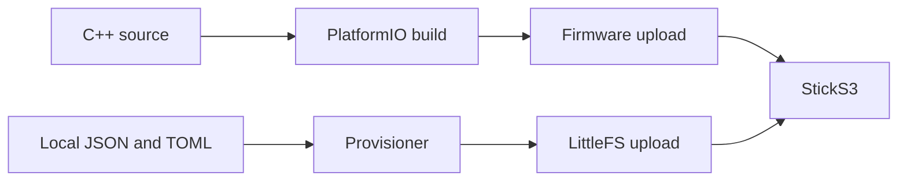

# Light Controller for StickS3

Arduino C++ firmware for the **M5Stack StickS3 K150**. **A** (front, GPIO11)
cycles modes; **B** (side user button, GPIO12) applies the selection. The separate
power/reset button keeps its system function.

The top right shows battery percentage and charging state. A discharging battery
at 20% or below turns red. Readings update every 15 seconds.


## Install

Requires Python 3.11+, Git, Make, a C++ compiler and a USB data cable.
On macOS, install Apple's Command Line Tools if needed.

From `sticks3/`:

```sh
make setup
make build
make provision CONFIG=/path/to/config.json SETTINGS=/path/to/settings.toml
.venv/bin/pio device list
make upload PORT=/dev/cu.usbmodem101
make upload-data PORT=/dev/cu.usbmodem101
```

Use the port listed for your device. The configuration files may live outside
this checkout; see the [configuration reference](../docs/CONFIGURATION.md).



`upload` updates firmware and preserves settings. `upload-data` replaces the
settings partition with local `data/`. Both restart the device. Once provisioned,
normal firmware updates need only `make upload`.

For HTTPS, add `CA=/path/to/ca.pem` to `make provision`. The device verifies the
server certificate and uses NTP to establish its clock.

## Checks and diagnostics

```sh
make check                    # Host C++ and provisioning checks
make e2e PORT=/dev/cu.usbmodem101
make monitor PORT=/dev/cu.usbmodem101
```

`make e2e-live` also changes the light and restores its original state. See
[testing and recovery](../docs/TESTING.md) for coverage, outputs and recovery.

Serial commands are newline-delimited JSON, for example `{"cmd":"status"}`:

| Command | Effect |
| --- | --- |
| `status` | Board, battery, Wi-Fi, current selection and backlight settings |
| `frame` | Rendered pixels and the state used to draw them |
| `next` | Select the next mode |
| `apply` | Send the selected mode to the real light |
| `ha_check` | Read HA API and configured entity |
| `wifi_scan` | Check configured network visibility; retry association if offline |

To replace the app temporarily with the hardware diagnostic:

```sh
make diagnostic
.venv/bin/pio run -e diagnostic -t upload --upload-port /dev/cu.usbmodem101
```

It reports display size, PSRAM, battery and physical button presses. Run
`make upload` afterward to restore the app.

## Hardware and build notes

- Portrait rotation is `0`; use `2` in `src/main.cpp` for the opposite orientation.
- The app uses 20 kHz backlight PWM at brightness 128/255. This fixed the observed
  idle flicker. `status` reports the actual frequency and brightness.
- Failed Wi-Fi connections retry every 30 seconds. Battery endurance and sleep
  behavior have not been measured.
- [platformio.ini](platformio.ini) pins the build and library versions. M5Unified
  supplies display/button/power support; audio, IMU and RTC startup are disabled.
- `make setup` builds a native LittleFS tool on Apple Silicon. Uploads use
  115200 baud and a watchdog reset for reliable USB restart on macOS.

If upload cannot connect, hold the side reset button until the internal green
LED flashes, then retry. See the [official StickS3 documentation](https://docs.m5stack.com/en/core/StickS3).

## Files

| Path | Purpose |
| --- | --- |
| `src/main.cpp` | Hardware, files, Wi-Fi, HTTP and serial commands |
| `src/controller.cpp` | Mode selection, applied state and HA payloads |
| `src/screen.cpp`, `include/bitmaps.h` | Framebuffer, typography and icons |
| `scripts/`, `tests/` | Provisioning, checks and hardware verification |

